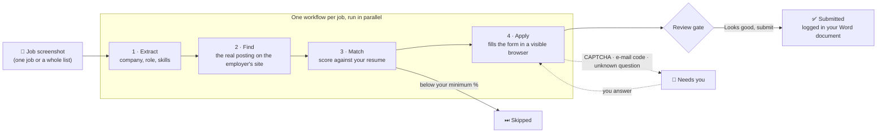

<h1 align="center">JobApplier</h1>

<p align="center">
  <b>Screenshot any job. An AI agent finds the real posting, fills in the application,<br/>and waits for your OK before it submits.</b>
</p>

<p align="center">
  <a href="https://github.com/TanmayS0406/JobApplier/stargazers"></a>
  
  
  
  
  
</p>

<p align="center">
  <a href="#quick-start">Quick start</a> ·
  <a href="#how-it-works">How it works</a> ·
  <a href="#what-makes-it-different">Why it's different</a> ·
  <a href="#documentation">Docs</a> ·
  <a href="#help-wanted">Contribute</a>
</p>

<!-- Put a demo GIF here (screenshot dropped on the dashboard -> job card -> "Needs you" -> submitted). It is the single biggest thing a README can add. -->

---

Applying for jobs is the same form, typed again, fifty times. **JobApplier turns a screenshot into an application**: a LinkedIn
or Indeed listing, a careers page, a recruiter's message, a post a friend shared. If the screenshot shows the role and the company,
that is enough. One screenshot can hold a single posting or a whole page of results, and every job in it is handled **in parallel**.

It is a local app that runs on **your own Claude or GitHub Copilot account** (OAuth sign-in, no API key), drives **a real, visible browser**, and
keeps you in charge: by default every application stops at a review step until you say go.

| 1. Add your resume | 2. Drop a screenshot | 3. Press **Start jobs** |
|---|---|---|
| Once, on the **Profile** page. | On the **Dashboard**, or paste it with `Ctrl+V`. | Look over each form, then approve it (or turn on auto-submit). |

## What makes it different

- 🔎 **It finds the real posting.** A screenshot is only the starting point. The agent locates the job on the employer's own careers
  site or applicant-tracking system and applies *there*. LinkedIn itself is never logged into or automated.
- 🙋 **A human stays in the loop.** CAPTCHA, an e-mail verification code, a question your profile can't answer: that one job pauses
  and asks you on the dashboard (orange **Needs you** card, tab-title alert, a short beep) while the others keep running.
  Eligibility and legal questions are **asked, never guessed**.
- ⚡ **Parallel by design.** Up to 8 jobs at once, each with its own agent process and its own browser window.
- 🛂 **Apply only where the employer helps you move.** Tick *Only apply if the job offers visa sponsorship or relocation* and a job is
  applied for only when its posting says so. A posting that is silent, or says no, is skipped, and *Apply anyway* overrides it.
- 🔐 **Passwords never reach the model.** A strong password is generated per site and substituted *inside* the browser tool. The
  agent only ever types a placeholder name, and tool output is redacted.
- 💾 **Close it, kill it, reboot. Nothing is lost.** Jobs live in SQL Server behind a durable Hangfire queue and continue **from the
  stage they reached**. Hit your Claude or Copilot usage limit? The job waits for the reset and **resumes by itself** - or, with *Pause when the usage limit ends* in Settings, waits for your **Resume now** so you can use Claude elsewhere.
- 📬 **See who answered.** Optional reply tracking reads your Gmail through your Claude account's Gmail connector (read-only, **no
  Google sign-in, no Cloud project**) and labels each application: received, moving forward, info requested, rejected, offer.
  Filter by rejected, info requested or skipped, and press **Reply**: Claude drafts an answer, you edit it, and it is sent only when you press Send.
- 📈 **Resume gap analysis.** The Insights page counts the skills your collected jobs keep asking for, ranks which single resume
  change would lift the most of them over your match threshold, and refuses to suggest claiming anything your resume can't back up.
- 🏠 **Local only.** The UI and its MCP endpoint listen on `127.0.0.1` and nowhere else. Your data stays on your PC, apart from what
  the AI provider you picked needs to do the work.

## How it works



Each stage is an executor in a [Microsoft Agent Framework](https://github.com/microsoft/agent-framework) workflow, backed by the
Claude Code CLI (`claude -p`) or the GitHub Copilot CLI (`copilot -p`), each signed in with your own OAuth login. The agents are locked down: no shell or code
tools, only a [Playwright MCP](https://github.com/microsoft/playwright-mcp) browser and this app's own tiny MCP server, with file
access confined to the job's workspace.

**The match score is computed by the app, not the model**, so it is stable: the agent rates five dimensions 0-100 from evidence in
your resume, and the app weights them as `skills 40% + experience 25% + domain 15% + seniority 10% + logistics 10%`.

The full tour (the architecture, human-in-the-loop details, duplicate guard, usage limits, retries) is in
[docs/how-it-works.md](docs/how-it-works.md).

## Quick start

**You need**

| | |
|---|---|
| **Windows** | Built and tested on Windows. macOS and Linux are not supported yet (see [Help wanted](#help-wanted)). |
| **.NET 10 SDK** | to build and run |
| **Node.js 18+** | runs `npx @playwright/mcp` |
| **SQL Server** | the free *Express* edition or *LocalDB* is enough |
| **Chrome or Edge** | the browser the agent drives |
| **An AI account** | the [Claude Code CLI](https://claude.com/claude-code) (needs a Claude Pro / Max / Team / Enterprise login) **or** the [GitHub Copilot CLI](https://docs.github.com/copilot/how-tos/copilot-cli/set-up-copilot-cli/install-copilot-cli) with a GitHub account that has Copilot; Settings can install it for you |

**Run it**

```powershell
git clone https://github.com/TanmayS0406/JobApplier.git
cd JobApplier
dotnet run --project src/JobApplier
```

It opens <http://127.0.0.1:5189> in your browser. On the first start it **creates and migrates its own database**, so there is
nothing to set up by hand. (A different SQL Server? Set `ConnectionStrings__JobApplier`; see
[the database and the queue](docs/queue-and-database.md).)

**First run, in three steps**

1. **Settings** → pick Claude or GitHub Copilot and sign in (a window and your browser open for the CLI's own OAuth sign-in). Already signed in to either CLI? It's picked up automatically.
2. **Profile** → upload your resume (PDF, Word, text or image). It is read into the form; fix anything wrong and fill in what
   resumes don't say (work authorisation, notice period, expected salary), or leave it blank and be asked when a form needs it.
3. **Dashboard** → drop screenshots → **Start jobs**. Applications are *filled in but not submitted*; check the form in the browser
   window and press **Looks good - submit it**.

More detail, including auto-submit and the GitHub Copilot sign-in walkthrough: [docs/getting-started.md](docs/getting-started.md) and
[docs/ai-providers.md](docs/ai-providers.md).

> [!WARNING]
> **Use at your own risk.** Automating applications can get an account flagged or banned on some sites, and an application sent in
> your name is yours. That is why review-before-submit is on by default. Leave it on until you have watched a few runs.

## Everything it does

| | |
|---|---|
| **Reads screenshots** | company, role, location, skills, description, from any source. A screenshot of a *list* is split into one job per entry. |
| **Scores every job** | a weighted match against your resume, with the skills you have and the gaps shown on each job's page. |
| **Filters for visa and relocation** | optionally skips jobs whose posting does not offer visa sponsorship or relocation help, and shows what the posting said. |
| **Fills in applications** | creates an account with a generated password when the site needs one, signs in again later, uploads your exact resume file. |
| **Never applies twice** | the same posting URL (tracking parameters ignored) is claimed under one lock, so parallel jobs can't race. |
| **Keeps records** | one Word document on your Desktop with every account (site, e-mail, password) and every application (company, role, URL). |
| **Survives interruptions** | durable queue, per-stage checkpoints, automatic wait-and-resume on usage limits, a queue dashboard at `/hangfire`. |
| **Retries on your terms** | *Retry all failed*, *Retry when available*, and a dialog to choose auto-submit and minimum match for each retry. |
| **Sorts and filters** | results and replies by newest or match %, filtered by "match at least 50-90%" and by outcome (rejected, info requested, skipped, no reply yet...), paged, and kept in the URL. |
| **Tracks employer replies** | optional, English and Spanish; reading is read-only. You can have Claude draft an answer and send it with one click. See [docs/gmail-replies.md](docs/gmail-replies.md). |
| **Explains your gaps** | skill gaps, a "what to change first" plan with a Monte Carlo range, and job families. See [docs/resume-insights.md](docs/resume-insights.md). |

## Safe by default

- **Review before submit** is on until *you* turn auto-submit on, and there is a *minimum match %* to skip poor fits.
- **Web pages, screenshots and job descriptions are treated as untrusted data.** The agent is told never to follow instructions found
  in them, never to type your details anywhere but the application form, and never to pay, download or install anything.
- **Strict by construction.** Agents run with `--strict-mcp-config` and a permission mode that denies anything not explicitly
  allowed; the Gmail scan and the drafting of an answer are limited, by tool name, to the connector's search and read tools, and the
  one run that sends an answer (only when you press Send) gets the connector's reply tool and nothing else.
- **The job log shows what the agent *did* ("typed into *Password field*"), never what it typed.**
- Anti-forgery tokens on every form, a strict Content-Security-Policy, and a per-run bearer token on the MCP endpoint.

> Instructions to an AI model are a strong default, not a guarantee. Details and limits: [docs/security-and-privacy.md](docs/security-and-privacy.md).

## Honest limits

- **Not every site works.** Standard forms on Greenhouse, Lever, Ashby, SmartRecruiters and many company sites do. Heavily
  customised portals, "Easy Apply inside LinkedIn", and sites that block automation may need your help or fail. A failed job keeps
  its log so you can see how far it got.
- **Windows only for now.** The sign-in and install windows, and the browser lookup, are Windows-specific.
- **It uses your AI quota.** A typical job is a few minutes of agent time on your Claude subscription or GitHub Copilot account.
- **The GitHub Copilot provider has not been run against a live Copilot account yet.** It follows the CLI's documented interface and is
  covered by tests against a stand-in `copilot`; Claude is the provider that has been run end to end. Reports from real Copilot runs are welcome.
- **A job only counts as offering visa sponsorship or relocation if its posting says so.** A posting that is silent is skipped when you
  ask for that, and a screenshot of a list entry has little text to go on.
- **Gmail reply tracking has not been tested against a real mailbox yet.** It is covered against a fake `claude` CLI; reports from real use are welcome.
  That goes double for **sending an answer**: it has never sent a real mail. Check the first one in your Gmail's *Sent* folder (and send the first one to
  an address you control) before relying on it.

## Under the hood

| | |
|---|---|
| **App** | ASP.NET Core MVC on .NET 10, live-updating dashboard |
| **Agents** | [Microsoft Agent Framework](https://github.com/microsoft/agent-framework) workflows; `ClaudeCodeAgent` and `CopilotCliAgent` are real `AIAgent`s over the CLIs |
| **Browser** | [Playwright MCP](https://github.com/microsoft/playwright-mcp), pinned to a version so a release can't change behaviour under you |
| **Queue and data** | Hangfire + SQL Server through EF Core, with migrations applied at start-up |
| **Analytics** | ML.NET (TF-IDF, K-Means) and Math.NET Numerics (regression, Monte Carlo) |
| **Documents** | Open XML SDK writes the accounts document |
| **Tests** | xUnit, 760+ tests. The AI CLI is replaced by a fake that records its arguments; SQLite stands in for SQL Server |

Beyond the unit tests, the whole pipeline was run live against the real Claude CLI, a real browser and a local fake company portal
(CAPTCHA wall, sign-up with a password policy, file upload, a question the profile couldn't answer, a review gate): three jobs in
parallel, cancellation with no leftover processes, account reuse and the duplicate guard.

## Documentation

| | |
|---|---|
| [Getting started in detail](docs/getting-started.md) | first run, auto-submit |
| [How it works](docs/how-it-works.md) | architecture, locked-down agents, passwords, human help, retries, usage limits, match score |
| [Claude or GitHub Copilot](docs/ai-providers.md) | differences between providers, Copilot sign-in |
| [The database and the queue](docs/queue-and-database.md) | SQL Server, Hangfire, restarts, migrations, upgrading |
| [Gmail replies](docs/gmail-replies.md) | setup, what is read, what is kept |
| [Resume gaps (Insights)](docs/resume-insights.md) | how the analysis works and its limits |
| [Configuration and data](docs/configuration.md) | every setting, where files live, the accounts document |
| [Security, privacy and known limits](docs/security-and-privacy.md) | what leaves your PC and what doesn't |
| [Development](docs/development.md) | project layout, running the tests |

## Help wanted

JobApplier is young and there is a lot of room to help. Good places to start:

- 🖥️ **macOS and Linux support.** The sign-in windows go through `cmd.exe` and the browser lookup uses Windows paths.
- 🧪 **Tell us which sites work.** Run it against more applicant-tracking systems and open an issue with what worked or failed.
- 🤖 **Try the GitHub Copilot provider with a real account.** It is built from the CLI's documented interface and tested against a stand-in, so a
  report from a live run (what worked, what the job log says when it did not) is the most useful thing you can send.
- 🌍 **More languages** for reply detection (English and Spanish today) and for the questions the agent asks you.
- 🎬 **A demo GIF or screenshots** of the dashboard. Every README needs one, and this one doesn't have one yet.
- 🐛 **Bug reports** from real runs are the most useful thing there is.

```powershell
dotnet test        # run the whole suite; no AI account or SQL Server needed
```

See [docs/development.md](docs/development.md) for the project layout. Pull requests are welcome.

---

<p align="center">
  <b>⭐ If JobApplier saves you an evening of pasting your resume into forms, a star helps other job-seekers find it.</b><br/>
  Built by <a href="https://github.com/TanmayS0406">TanmayS0406</a>. <a href="https://github.com/TanmayS0406">Follow</a> for updates.
</p>
